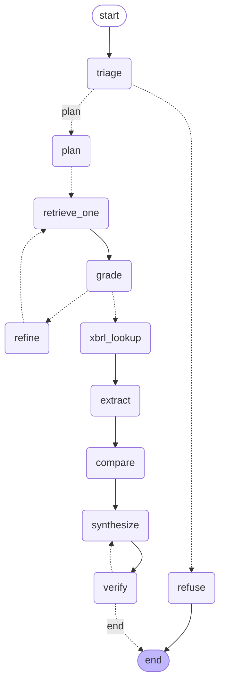

# Multi-Hop Filings Analyst

A RAG + agent system that answers comparative questions over SEC 10-K filings with
span-level citations, XBRL-grounded numbers, and an eval-gated CI pipeline. LLMs
hallucinate numbers; this system never lets the LLM produce a figure from prose —
figures come from the SEC's structured XBRL API, narrative comes from retrieval over
the filing text, and a deterministic verification node rejects any answer containing a
number or citation that isn't traceable to one of those two sources.

The demo page (`make run`, then open `http://localhost:8000`) is a single HTML file:
a question box, an answer with inline `[C1]`-style citation markers that jump to an
expandable citation list with links back to the original SEC filing, a thumbs up/down
that posts to `/feedback`, and a LangSmith trace link.

## Quickstart

```bash
cp .env.example .env      # fill in the five keys below — every one is free, no card required
make preflight             # live pass/fail check for each key
make ingest                 # ~526 chunks, ~204k embedding tokens (see Cost below), a few minutes
make run                    # http://localhost:8000
```

Keys needed (`.env.example` has the exact free-tier signup links):

| Variable | Where to get it |
|---|---|
| `GOOGLE_API_KEY` | [aistudio.google.com/apikey](https://aistudio.google.com/apikey) |
| `GROQ_API_KEY` | [console.groq.com/keys](https://console.groq.com/keys) |
| `PINECONE_API_KEY` | [app.pinecone.io](https://app.pinecone.io) |
| `LANGSMITH_API_KEY` | [smith.langchain.com](https://smith.langchain.com) |
| `SEC_USER_AGENT` | none needed — just set it to `"Your Name you@example.com"` |

`make ingest --dry-run` (via `uv run python -m filings_analyst.ingest.pipeline --dry-run`)
prints the full plan — filings resolved, chunks per section, token estimate — without
touching Pinecone, and needs only `SEC_USER_AGENT` (EDGAR requires no API key at all).

## Architecture



(Generated directly from the compiled graph: `uv run python -m filings_analyst.agent.graph --mermaid`.)

**Ingestion** (`edgar/`, `ingest/`) resolves each company's FY2023/FY2024 10-K from
EDGAR's submissions API, extracts Items 1A/7/7A from the primary HTML document, chunks
each section (~450 tokens, 80 overlap, never crossing an item boundary), and upserts
into a single Pinecone index using server-side embedding.

**Retrieval** (`retrieval/`) is metadata-filtered vector search plus a budgeted rerank.

**The agent** (`agent/`) is a LangGraph `StateGraph`: triage decides in/out of corpus;
plan decomposes the question into up to 4 sub-queries; retrieval fans out over them
with LangGraph `Send` (`max_concurrency=3`); grading is one batched fast-model call over
all candidates; if a sub-query's evidence is thin, `refine` rewrites it and loops back
through retrieval (bounded by `MAX_HOPS`); XBRL lookups run deterministically alongside
extraction; synthesis writes the cited answer; `verify` is pure Python — no LLM — and
checks every citation marker resolves, every cited source is real, and every number in
the answer traces to an extracted or XBRL fact, looping back to `synthesize` (max 2
attempts) and, failing that, deterministically stripping unsupported sentences rather
than ever emitting an unverifiable claim.

**Observability** (`obs/`) is structured JSON logs (per-node latency, evidence counts,
cache hit/miss, rerank budget) plus sampled LangSmith tracing, so the project isn't
fully dependent on a SaaS dashboard staying reachable.

## Design decisions

**LangGraph over a linear chain.** The `grade → refine → retrieve` cycle is the reason
this is a graph: retrieval quality is checked and, if thin, actively repaired *before*
synthesis ever sees it, rather than synthesizing over whatever the first retrieval pass
happened to return. A linear chain can't loop back on itself. `SqliteSaver` checkpointing
comes along for free with the graph model, making every thread resumable.

**Numbers from XBRL, narrative from RAG.** This is the core hallucination-containment
argument: an LLM asked to "extract" a number from prose can still round, misread a
comparative-year column, or invent one under pressure to answer. Structured XBRL data
can't be misread the same way — it's a lookup, not a comprehension task. `verify`
enforces the boundary at runtime rather than trusting the synthesizer to respect it.

**Section-scoped ingestion (1A/7/7A only), rejected: the full 10-K.** A full 10-K is
70-90% boilerplate, cover pages, signatures, and financial-statement tables that add
noise without adding retrieval precision — and would blow the embedding budget across
8 filings for no benefit, since exact numbers come from XBRL, not from these chunks.

**One index + metadata filters, rejected: a namespace per company.** Pinecone queries a
single namespace at a time, and this system's core query pattern is cross-company and
cross-year — a namespace per ticker would turn every comparative question into N
queries plus a manual merge. A single namespace with `ticker`/`fiscal_year`/`item`
metadata filters keeps every query pattern (single-company, cross-company, cross-year)
to one call.

**Two-provider model routing.** Groq's free tier is fast (30 RPM) but has only ~6,000
tokens/min — nowhere near enough for retrieved context. Gemini Flash's free tier has a
much higher token ceiling but a tighter RPM limit. The split follows directly from
that: triage/plan/grade/refine never see retrieved text and go to Groq; extract/
compare/synthesize always see retrieved text and go to Gemini. `assert_short()` is a
runtime guard, not just a convention, specifically because it's easy to accidentally
route a chunk-laden prompt to the wrong model while iterating.

**Batched grading in one call, rejected: one call per chunk.** With up to 4 sub-queries
each returning several candidates, per-chunk grading would multiply LLM calls linearly
with retrieval breadth. A single batched call (chunk_id + a text preview per candidate,
one JSON array back) keeps grading at exactly 1 call regardless of how many candidates
came back, which is what keeps a full multi-hop question under the ~12-call budget.

**A deterministic verification node, rejected: trusting the synthesizer.** Every LLM,
including one instructed not to hallucinate, will occasionally hallucinate anyway. The
fix is not a better prompt; it's a rules-based check that runs after generation and
can't be argued with: every `[Cn]` in the text must have a matching citation, every
citation's source must be a real retrieved chunk or a real XBRL fact, and every
financial-looking number in the answer must appear among the extracted facts. See
`tests/test_verification.py`, which exercises a fabricated citation and a fabricated
XBRL source directly. Writing those tests caught two real bugs in the number-matching
logic before they ever reached a live answer — see Limitations.

**Eval-gated CI, rejected: no regression tests for the RAG system.** A retrieval +
generation pipeline has more ways to silently regress than a typical service — a prompt
edit that quietly drops a citation rule, a chunking change that shifts recall — and none
of that shows up in a type checker or a unit test of `chunk_section()`. The smoke eval
in CI is the test suite for the parts that only fail in aggregate.

**SQLite LLM cache and trace sampling.** Both are direct engineering responses to the
free-tier ceilings in the constraints table: the cache means re-running an eval suite
(or restarting `make run` during development) doesn't re-consume Gemini/Groq quota for
identical prompts, and `LANGSMITH_SAMPLE_RATE` is what keeps a real-traffic deployment
under LangSmith's 5,000-traces/month cap without turning tracing off entirely.

**Model/library ID verification.** Per the build brief's own instruction to verify
rather than assume: the SPEC's Pinecone usage sketch (`create_index_for_model`,
`upsert_records`, unified `index.search(rerank=...)`) does not exist in the `pinecone`
SDK version that was initially pinned (5.4.2) — it was added in a later major version.
The dependency was bumped to `pinecone>=10.0.0,<11` after confirming the actual method
signatures against the installed package directly (see commit history), rather than
assuming the spec's sketch still matched current docs. `GEMINI_MODEL`/`FAST_MODEL` IDs
in the spec were current as of this build and were not substituted.

## Evaluation

`evals/dataset.jsonl` has 30 items: 6 numeric, 8 single-hop, 8 multi-hop, 4
contradiction, 4 unanswerable.

**Provenance, stated plainly:** this dataset was **not** produced by the normal
`make_dataset.py` flow (generate candidates with the long model from real chunks, then
human-review before committing) — this build environment had no live Google/Groq API
keys to run that generation step. Instead, every item was constructed directly against
real, verified data pulled during development:

- Every `gold_chunk_id` is a real chunk ID, cross-checked against an actual offline run
  of `ingest.pipeline.build_plan()` against live SEC EDGAR (the same function `make
  ingest` calls, minus the Pinecone upsert) — not invented.
- Every `gold_numbers` value was fetched live from the XBRL `companyconcept` API during
  this build and matches known public figures (e.g. NVIDIA's FY2024 revenue,
  $60,922,000,000; Apple's FY2024 R&D expense, $31,370,000,000).

This is a *different* provenance guarantee than the spec's default flow, not a weaker
one in isolation — every gold label is real, checkable data — but it means
`make_dataset.py` itself, while written to the same verified APIs as the rest of this
codebase, has not been exercised end-to-end, and the dataset does not benefit from an
LLM's help surfacing non-obvious questions the way the intended flow does.

**Results — not run.** Actually running `make eval SUITE=smoke` requires live
Google/Groq/Pinecone/LangSmith credentials and a completed `make ingest`, neither of
which this build environment has. No results table is committed under
`evals/results/` because there is no real run to report — fabricating one would defeat
the entire point of an eval-gated pipeline. **This is the one Definition-of-Done item
left for whoever runs this with real keys:** `make ingest && make eval SUITE=smoke`
will populate `evals/results/{date}-smoke.md`, which should then be committed.

## Cost and quota analysis

From the real ingest dry-run against all 8 filings (`make ingest --dry-run`):

| | |
|---|---|
| Filings | 8 (4 companies × FY2023/FY2024) |
| Chunks | 526 |
| Estimated embedding tokens | 204,289 (14% of the 1,500,000 budget) |

Per-question cost, worst case (multi-hop, one refine hop triggered):

| Node | Calls | Model |
|---|---|---|
| triage | 1 | fast |
| plan | 1 | fast |
| grade | 1 (batched over all candidates) | fast |
| refine | ≤2 (one per thin sub-query, bounded by `MAX_HOPS=2`) | fast |
| xbrl_lookup | 0 | none (deterministic) |
| extract | 1 | long |
| compare | 1 | long |
| synthesize | 1-2 (repair loop, max 2 attempts) | long |
| verify | 0 | none (deterministic) |
| **Total** | **≤9** | — |

Under the spec's ≤12-call budget with room to spare. At ~10 LangSmith traces per `/ask`
(the root run plus per-node and per-LLM-call child runs), the 5,000-traces/month
Developer-plan cap supports roughly **500 fully-sampled questions/month**
(`LANGSMITH_SAMPLE_RATE=1.0`), or proportionally more at a lower sample rate — e.g.
~1,600/month at `0.3`. Groq's free tier (30 RPM / ~6k TPM) is never the bottleneck for
this workload since retrieved context never reaches it. Pinecone Starter's 500
rerank-requests/month is the tightest budget under sustained use; `retrieval/rerank.py`
tracks usage in `data/rerank_budget.json` and falls back to unranked vector order
rather than erroring once exhausted.

## Limitations

- **Judge-model bias.** `JUDGE_MODEL` and `LONG_MODEL` are both Gemini Flash — the same
  family judging its own family's output. `answer_correctness` and `citation_support`
  scores should be read as directionally useful, not as an independent audit.
- **8-filing corpus.** Four companies, two fiscal years each. Findings don't generalize
  beyond this fixed universe by design.
- **XBRL tag inconsistency across filers.** `config/xbrl_tags.yaml` lists several
  candidate tags per concept and takes the first that resolves for the exact filing
  (matched by accession number + period-end date, not by the API's own fy/fp labels,
  which are sometimes inconsistent). This worked for all tested concepts across all 4
  companies, but a fifth company could still use a tag not in the candidate list.
- **Pinecone Starter pauses idle indexes after ~3 weeks.** A first query after a long
  idle period may need to wake the index before it responds.
- **No streaming.** `/ask` returns only once the full graph run (up to ~9 LLM calls
  across two providers) completes; a multi-hop question with a refine hop can take
  tens of seconds.
- **Section-boundary regex is genuinely brittle, and this build hit two real examples
  of it, both fixed and covered by `tests/test_sections.py`:**
  - Running page headers/footers (e.g. a bare `"Item 1A"` repeated on every page of
    Microsoft's risk-factors section) were, before the fix, corrupting the "last
    occurrence" heuristic used to skip the table of contents — the boundary was
    landing on the last page's running header instead of the real heading, silently
    swapping large chunks of Item 7's real content into the "Item 1A" section.
  - JPMorgan's Item 7 and 7A in the strict Part II numbering are short
    incorporation-by-reference stubs pointing at a separately-labeled MD&A elsewhere in
    the document (common for bank holding companies) — the extractor correctly finds
    the stub text (that's genuinely what's at that heading), but it means JPM-specific
    MD&A/market-risk retrieval in this corpus is thinner than for the other 3 companies.
    `contra-01` in the eval set tests that the system reports this honestly rather than
    inventing a contradiction it can't support.
- **`make_dataset.py`'s generate-then-review flow is untested end-to-end** — see
  Evaluation above.

## What I'd do next

- Hybrid sparse+dense retrieval (BM25 alongside the dense embedding) — risk-factor text
  is dense with exact-match terms (ticker-specific product names, regulation numbers)
  that dense embedding alone under-weights.
- A human-labeled eval set built the way the spec intends: `make_dataset.py` candidates
  reviewed by a person who isn't the model that generated them.
- Cross-encoder reranking as a fallback when the Pinecone rerank budget is exhausted,
  instead of degrading straight to unranked vector order.
- Streaming responses over the multi-hop path, so a user sees the plan and retrieved
  evidence progressively rather than waiting for the full graph run.
- Langfuse as a self-hosted tracing alternative, removing the 5,000-traces/month
  ceiling entirely for anyone willing to run their own collector.
